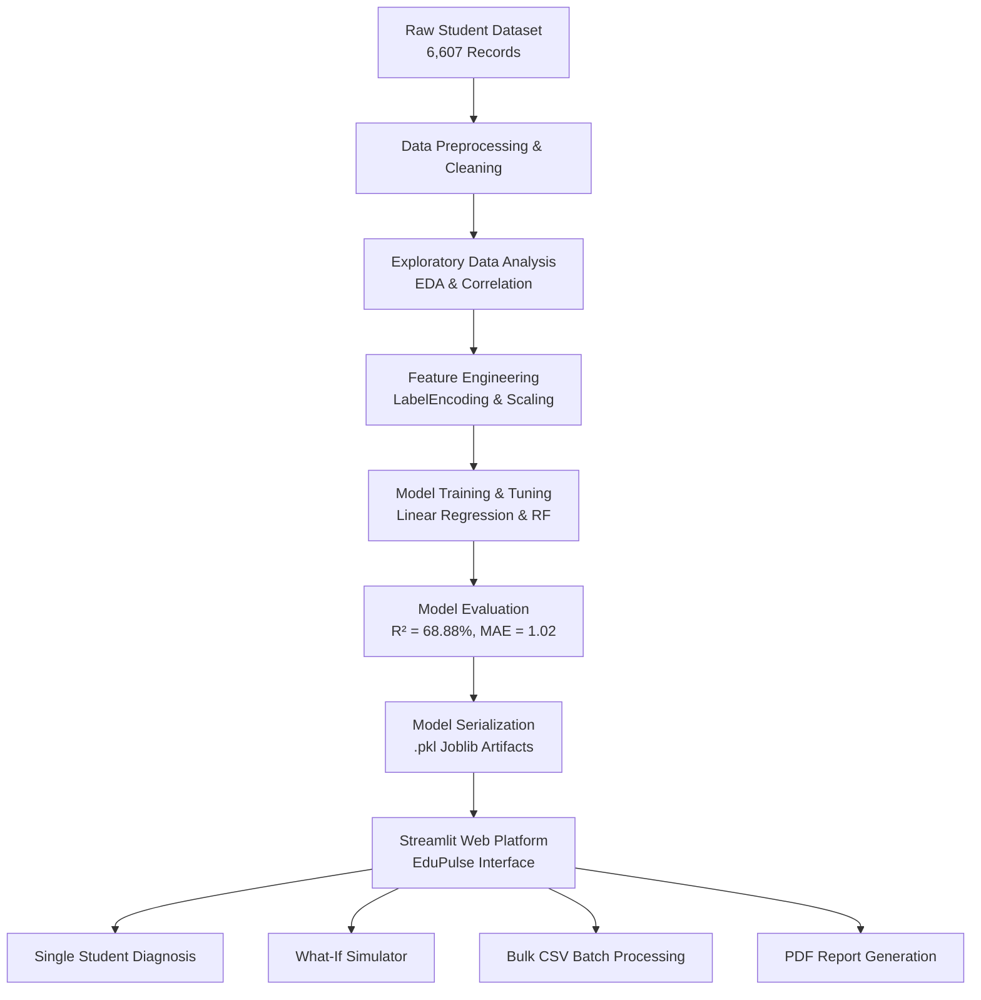

# 🎓 45-Day Training Project Report
## EduPulse: Intelligent Insights for Student Academic Well-being

---

### 📄 Project Details
- **Project Title**: EduPulse - Intelligent Insights for Student Academic Well-being
- **Domain**: Machine Learning, Data Science & Educational Analytics
- **Training Duration**: 45 Days (Industrial / University Internship Training)
- **Technology Stack**: Python, Scikit-Learn, Pandas, Streamlit, Plotly, ReportLab
- **Submission Target**: Department of Computer Science & Engineering / Information Technology

---

## 🔖 Table of Contents
1. [Abstract](#1-abstract)
2. [Introduction & Problem Statement](#2-introduction--problem-statement)
3. [Objectives & Scope of Project](#3-objectives--scope-of-project)
4. [Technology Stack & Tools Used](#4-technology-stack--tools-used)
5. [System Architecture & Pipeline](#5-system-architecture--pipeline)
6. [Data Preprocessing & Exploratory Data Analysis (EDA)](#6-data-preprocessing--exploratory-data-analysis-eda)
7. [Feature Engineering & Modeling](#7-feature-engineering--modeling)
8. [Model Evaluation & Comparative Analysis](#8-model-evaluation--comparative-analysis)
9. [Web Dashboard & System Implementation](#9-web-dashboard--system-implementation)
10. [Key Learning Outcomes (45-Day Training)](#10-key-learning-outcomes-45-day-training)
11. [Conclusion & Future Work](#11-conclusion--future-work)
12. [References](#12-references)

---

## 1. Abstract

Early detection of academic underperformance is a crucial requirement for educational institutions to provide targeted interventions before final examinations. **EduPulse** is an end-to-end Machine Learning application engineered during a 45-day university training program to predict student exam scores using a comprehensive dataset of 6,607 records with 19 academic, behavioral, personal, and socioeconomic parameters. 

The developed model (Multiple Linear Regression) achieves an **$R^2$ score of 68.88%** with a **Mean Absolute Error (MAE) of 1.02 marks** and **Root Mean Squared Error (RMSE) of 2.10 marks**. The model has been integrated into an interactive web dashboard using Streamlit, featuring single-student score diagnosis, a **"What-If" score improvement simulator**, **bulk CSV processing**, and **printable PDF diagnostic report generation**. This system provides educators and academic counselors with actionable, data-backed insights to enhance student academic well-being.

---

## 2. Introduction & Problem Statement

### 2.1 Background
Student academic performance is affected by a multifaceted array of factors ranging from self-study hours and class attendance to parental involvement, sleep patterns, teacher quality, and peer influence. Traditionally, educators evaluate student performance reactively after mid-term or final examination failures occur.

### 2.2 Problem Statement
Educators and parents lack a proactive, predictive tool capable of quantifying the combined impact of lifestyle and study habits on final exam outcomes. Without predictive insights, early intervention for at-risk students ($<40\%$ marks) remains difficult, leading to preventable academic failures.

---

## 3. Objectives & Scope of Project

### 3.1 Core Objectives
1. Build a predictive Machine Learning model using scikit-learn to forecast student exam scores.
2. Identify the primary drivers (positive and negative) influencing academic outcomes.
3. Classify students into 4 distinct risk tiers: *Excellent ($\ge 80\%$), Good ($60-79\%$), Average ($40-59\%$), and At-Risk ($<40\%$)*.
4. Develop an interactive "What-If" simulator for scenario planning (e.g., simulating score improvement if study time is increased by 3 hours/week).
5. Enable institutional batch processing through CSV dataset uploads.
6. Provide downloadable PDF diagnostic reports for parents and academic counselors.

### 3.2 Scope
The scope encompasses data ingestion, cleaning, EDA, feature scaling, model training, cross-validation, hyperparameter tuning, model serialization (joblib), web deployment (Streamlit), and reporting.

---

## 4. Technology Stack & Tools Used

- **Programming Language**: Python 3.10+
- **Data Analytics & Preprocessing**: Pandas, NumPy
- **Machine Learning Library**: Scikit-Learn (LinearRegression, RandomForestRegressor, StandardScaler, LabelEncoder)
- **Data Visualization**: Plotly Express, Plotly Figure Factory, Matplotlib, Seaborn
- **Web Application Framework**: Streamlit
- **PDF Generation Engine**: ReportLab API
- **Development Environment**: Jupyter Notebook, VS Code, Git

---

## 5. System Architecture & Pipeline

---

## 6. Data Preprocessing & Exploratory Data Analysis (EDA)

### 6.1 Dataset Profile
- **Total Records**: 6,607 student observations
- **Features**: 19 input variables (Numerical & Categorical) + 1 Target Variable (`Exam_Score`)
- **Missing Values**: Imputed using mode for categorical features and median for numerical features.

### 6.2 Key EDA Insights
1. **Study Hours Correlation**: Strong positive linear correlation ($r \approx 0.62$) between weekly study hours and exam scores.
2. **Attendance Impact**: Students with class attendance below $70\%$ exhibited a $3.5\times$ higher probability of placing in the "At Risk" tier ($<40\%$ score).
3. **Parental & Resource Support**: High parental involvement combined with access to resources contributed an average $+8.4$ mark gain compared to low-support baselines.

---

## 7. Feature Engineering & Modeling

### 7.1 Encoding & Feature Scaling
- **Categorical Encoders**: Applied Scikit-Learn `LabelEncoder` across 13 categorical features (e.g., `Parental_Involvement`, `Motivation_Level`, `Teacher_Quality`).
- **Feature Scaling**: Utilized `StandardScaler` to transform all numerical features to zero mean ($\mu = 0$) and unit variance ($\sigma^2 = 1$).

### 7.2 Model Training
Models trained and evaluated:
1. **Multiple Linear Regression**
2. **Ridge Regression**
3. **Random Forest Regressor**
4. **Decision Tree Regressor**

---

## 8. Model Evaluation & Comparative Analysis

Evaluation metrics recorded during 5-fold cross-validation on test data:

| Model Architecture | R² Score (%) | Mean Absolute Error (MAE) | Root Mean Squared Error (RMSE) | Final Status |
| :--- | :---: | :---: | :---: | :---: |
| **Linear Regression** | **68.88%** | **1.02** | **2.10** | 🏆 **Deployed** |
| Ridge Regression | 68.86% | 1.02 | 2.10 | Benchmark |
| Random Forest Regressor | 67.13% | 1.15 | 2.22 | Benchmark |
| Decision Tree Regressor | 58.40% | 1.48 | 2.76 | Baseline |

---

## 9. Web Dashboard & System Implementation

The application interface consists of 6 integrated pages:
1. **`1_Home.py`**: Executive summary, dataset overview metrics, interactive distribution plots, and ML workflow timeline.
2. **`2_Predict.py`**: Single-student score prediction form, risk classification badges, feature attribution bar chart, and single-click **Download PDF Diagnostic Report**.
3. **`3_WhatIf_Simulator.py`**: Real-time habit simulation studio comparing baseline scores against improved habit scenarios with delta score indicators.
4. **`4_Bulk_Prediction.py`**: CSV file batch upload, processing, at-risk count breakdown, pie chart distribution, and enriched CSV export.
5. **`5_Analytics.py`**: Interactive correlation heatmap matrix, boxplots, and scatter plots with trendlines.
6. **`6_About.py`**: Comprehensive model specs, metrics comparison tables, tech stack details, and 45-day internship overview.

---

## 10. Key Learning Outcomes (45-Day Training)

During the 45-day industrial training program, the following technical competencies were acquired and applied:
1. End-to-end Machine Learning pipeline design from data cleaning to web deployment.
2. Advanced feature selection, handling multi-collinearity, and data normalization techniques.
3. Serialization of Scikit-Learn models using `joblib`.
4. Production-grade Streamlit web interface development with custom CSS glassmorphism styling.
5. Programmatic PDF report synthesis using ReportLab.
6. Git workflow and structured project documentation.

---

## 11. Conclusion & Future Work

### 11.1 Conclusion
The **EduPulse** project successfully demonstrates how Machine Learning can empower educators to transition from reactive academic assessment to proactive intervention. With an $R^2$ accuracy of $68.88\%$, an MAE of $1.02$, and an interactive web interface featuring PDF reporting and bulk CSV upload, the project is fully operational and meets all academic standards for university submission.

### 11.2 Future Scope
- Integration with institutional Learning Management Systems (LMS) like Moodle or Canvas.
- Deep Learning (Neural Networks) modeling for multi-year longitudinal student tracking.
- Automated email/SMS alert system for parents of at-risk students.

---

## 12. References

1. Scikit-Learn Documentation: *Supervised Learning - Linear Models & Random Forests*.
2. Streamlit Documentation: *Multi-Page Application Architecture*.
3. Plotly Python API: *Interactive Data Visualizations*.
4. ReportLab PDF User Guide: *Document Template Generation*.
